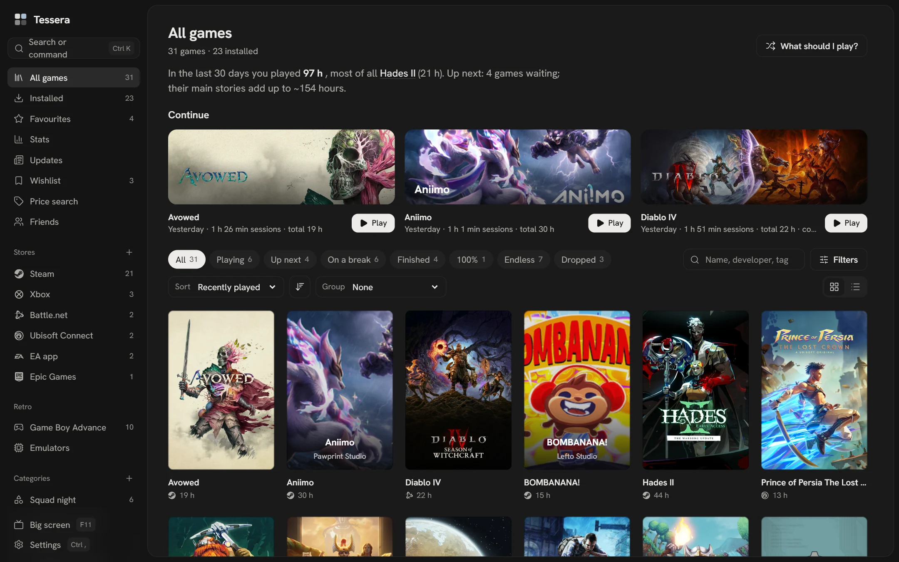
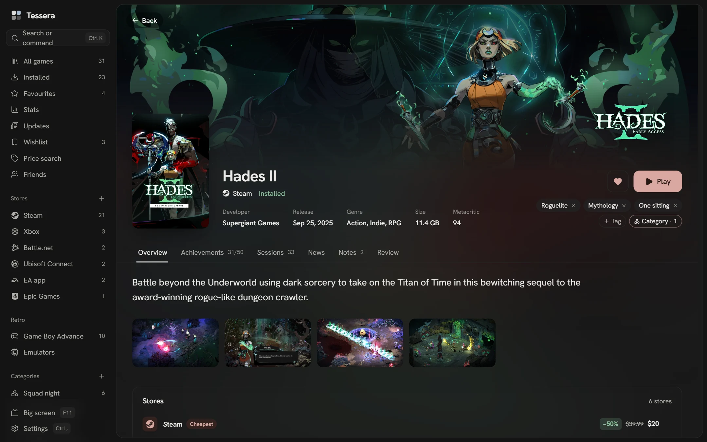
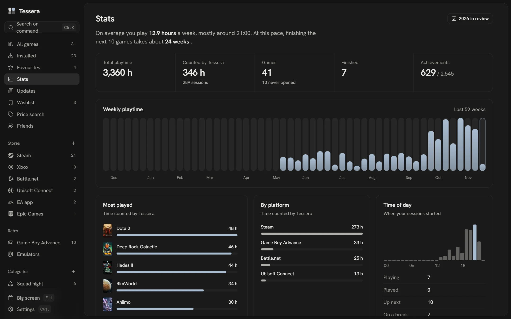
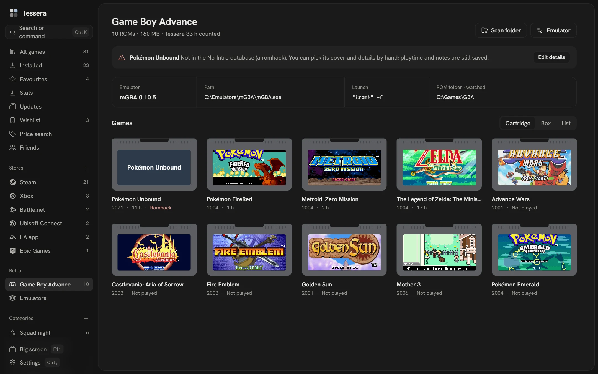
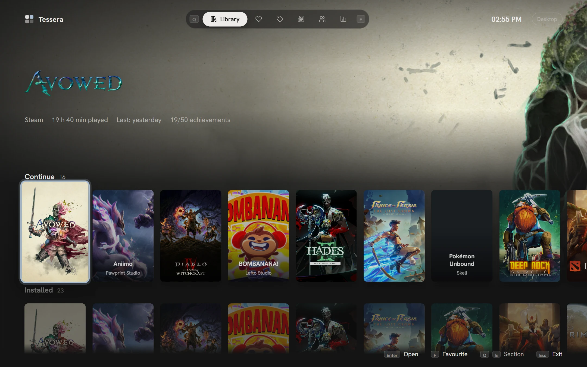
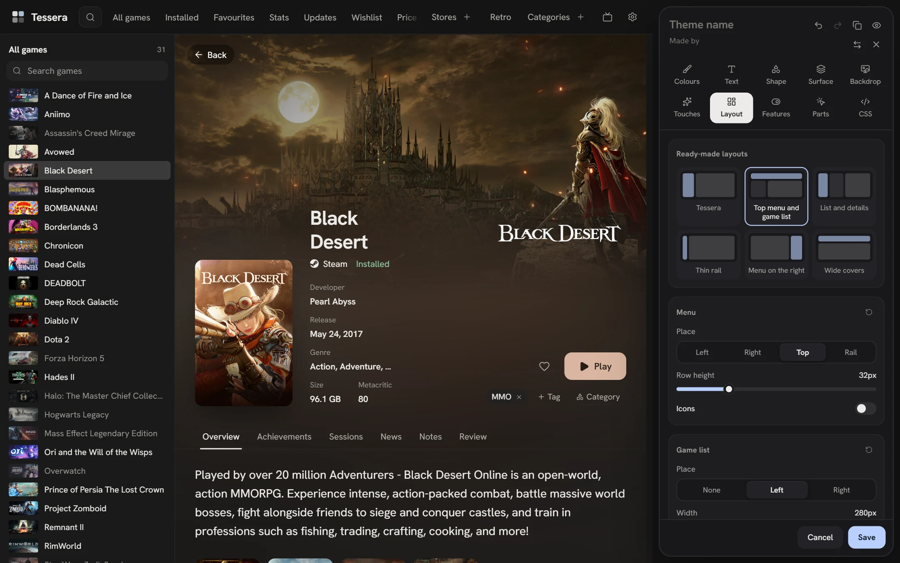

# Tessera

**English** · [Türkçe](README.tr.md)

An open source game library for Windows that brings your Steam, Epic, GOG, Xbox, Battle.net, EA and Ubisoft games and your retro ROMs together in one place.

**[Download](https://github.com/Labryse/tessera-app/releases/latest)** · Windows 10/11 · Free · GPL-3.0 · [Code signing policy](CODE_SIGNING.md)



## Library

Games from every store show up in one list. A game you own in two stores becomes a single card, with the play time added up. Filter by genre, tag, play time, score or Steam Deck support, and build categories that fill themselves from filters, or bring over the collections you made in Steam. When you can't decide what to play, Tessera picks a game for you, from the whole library or just the category you are in.

## Game page



A game's details, screenshots, achievements, your sessions and notes are on one page. Store prices sit side by side, price search opens on this week's best sellers and most played games you don't own and can be narrowed to one store or to games on sale, and when a game on your wishlist goes on sale you get a Windows notification.

## Statistics



How much you play each week, the hours you play most, and how long it would take to finish the games in your backlog. There is a year in review too, and a year, a month, your genres or a single game can be turned into a picture card to share.

## Retro



Point Tessera at your ROM folder. It recognises the games, finds their covers and opens them with the emulator you choose. Link your RetroAchievements account to see achievements as well.

## Big screen



A full-screen mode for the TV and a controller. Open it with F11, or with Start or the Xbox/PS button on your controller (Tessera asks first). The rest of the app works with a controller too: the d-pad moves between controls, A presses, B goes back.

## Theme studio



Besides the ready-made themes you can make your own: colours, fonts, corners, a background picture, where the menu sits, a game list column, which parts are shown, even the words in the menu. Changes show on the app as you make them. Themes can be copied as code and shared.

## Privacy

- No account is linked on its own; you choose what to link.
- You sign in on the platform's own page, so Tessera never sees your password. Keys are kept in Windows Credential Manager.
- Your data stays on your computer. Tessera has no server.
- Error reports go nowhere unless you send them.

[PRIVACY.md](PRIVACY.md) lists every server Tessera connects to and why.

## Development

```bash
npm install
npx tauri dev
```

To work on the interface only, `npm run dev` is enough; it opens in the browser with a sample library. For sources, how the connections work, releases and tests, see [docs/AYRINTILAR.md](docs/AYRINTILAR.md) (in Turkish).

## License

[GPL-3.0-or-later](LICENSE). Prices come from [IsThereAnyDeal](https://isthereanydeal.com/); Tessera is not affiliated with them. Game names and images belong to their owners.
