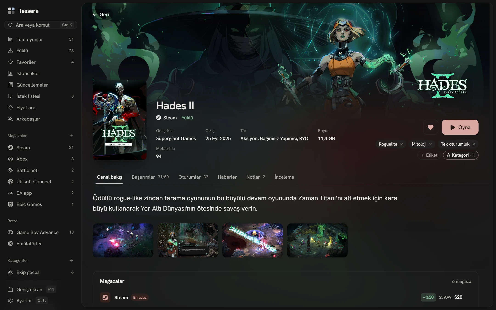
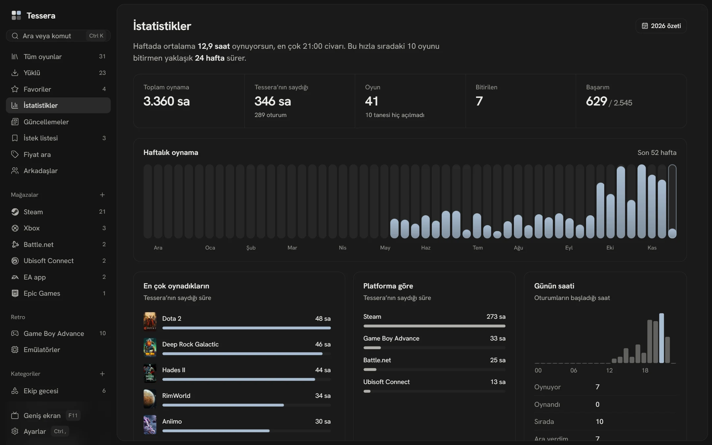
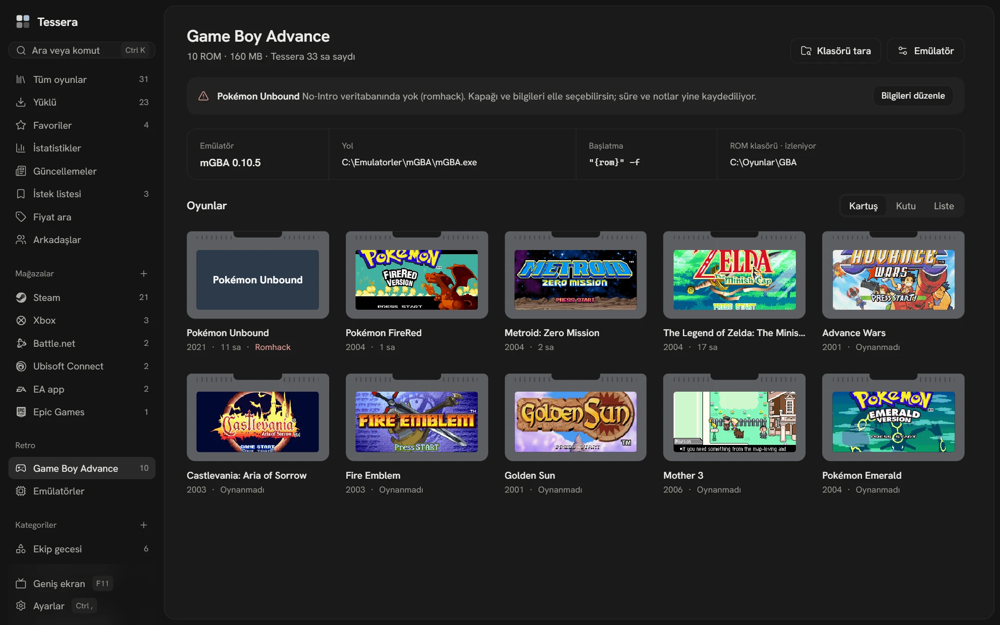
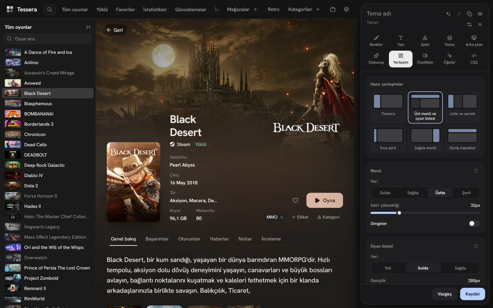

# Tessera

Steam, Epic, GOG, Xbox, Battle.net, EA ve Ubisoft oyunlarını ve retro ROM'ları tek bir yerde toplayan, Windows için açık kaynaklı bir oyun kütüphanesi.

**[İndir](https://github.com/Labryse/tessera-app/releases/latest)** · Windows 10/11 · Ücretsiz · GPL-3.0


## Kütüphane

Bütün mağazalardaki oyunların tek listede görünür. Aynı oyun iki mağazada varsa tek kart olur ve süreler toplanır. Türe, etikete, süreye, puana ya da Steam Deck desteğine göre filtreleyebilir, filtrelerden otomatik dolan kategoriler kurabilirsin. "Ne oynasam?" kararsız kaldığında bir oyun seçer.

## Oyun sayfası



Oyunun bilgileri, ekran görüntüleri, başarımları, oturumların, notların ve incelemen tek sayfada durur. Mağaza fiyatları yan yana görünür; istek listendeki oyun indirime girince Windows bildirimi gelir.

## İstatistikler



Haftada ne kadar oynadığını, en çok hangi saatlerde oynadığını ve sıradaki oyunları bitirmenin ne kadar süreceğini gösterir. Bir de yılın özeti var.

## Retro



ROM klasörünü gösterirsin; Tessera oyunları tanır, kapaklarını bulur ve seçtiğin emülatörle açar. RetroAchievements hesabını bağlarsan başarımlar da görünür.

## Geniş ekran


Televizyon ve kumanda için tam ekran mod. F11 ya da kumandadaki Start tuşuyla açılır.

## Tema stüdyosu



Hazır temaların yanında kendi temanı yapabilirsin: renkler, yazı tipleri, köşeler, arka plan resmi, menünün yeri, oyun listesi sütunu, hangi parçaların görüneceği, hatta menüdeki yazılar. Değişiklikler uygulamanın üstünde anında görünür. Temalar kod olarak kopyalanıp paylaşılabilir.

## Gizlilik

- Hiçbir hesap kendiliğinden bağlanmaz; neyi bağlayacağını sen seçersin.
- Girişler platformun kendi sayfasında yapılır, Tessera şifre görmez. Anahtarlar Windows Kimlik Bilgisi Yöneticisi'nde saklanır.
- Verilerin bilgisayarında kalır, Tessera'nın sunucusu yoktur.
- Hata raporları sen göndermedikçe hiçbir yere gitmez.

## Geliştirme

```bash
npm install
npx tauri dev
```

Sadece arayüz üzerinde çalışmak için `npm run dev` yeter; tarayıcıda örnek bir kütüphaneyle açılır. Kaynaklar, bağlantıların nasıl çalıştığı, sürüm çıkarma ve testler için bkz. [docs/AYRINTILAR.md](docs/AYRINTILAR.md).

## Lisans

[GPL-3.0-or-later](LICENSE). Fiyatlar [IsThereAnyDeal](https://isthereanydeal.com/) üzerinden gelir; Tessera onlarla bağlantılı değildir. Oyun adları ve görselleri sahiplerine aittir.
